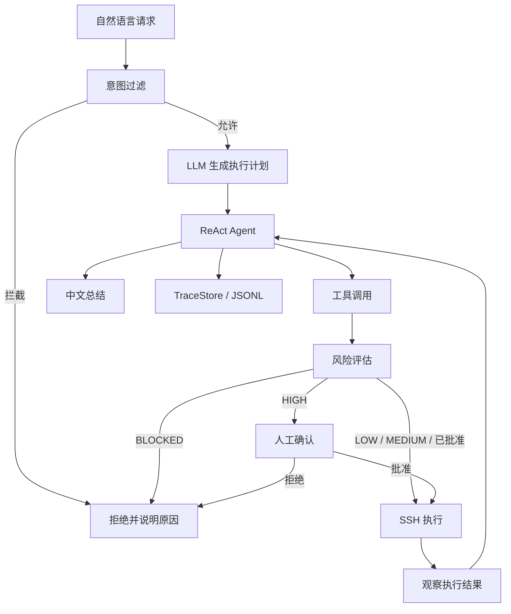

# LinuxAgent · 操作系统智能代理

<p align="center">
  <strong>通过自然语言规划和执行 Linux 运维任务，并提供可观察、可审批的安全控制流程</strong>
</p>

<p align="center">
  
  
  
  
</p>

LinuxAgent 是一个面向 Linux 运维场景的 Agent 原型。用户通过自然语言描述目标，系统先生成分步计划，再由 ReAct 循环选择工具、执行远程操作、观察结果并总结。每次工具调用前都会经过风险检查；执行过程写入结构化事件记录，便于复盘。

**重要：** Agent 会通过 SSH 对目标主机执行真实命令。本项目适合在隔离的测试虚拟机中学习和演示，不应未经安全评估直接连接生产服务器。

## 工作流程



## 核心能力

| 能力 | 说明 |
| --- | --- |
| 自然语言运维 | 使用模型理解任务并选择系统、磁盘、文件、进程、网络和用户工具 |
| Plan-Act | 先生成 1–5 步计划，再进入工具执行循环 |
| ReAct | 通过“调用工具 → 观察结果 → 再决策”处理多步骤任务 |
| 四层风险控制 | 意图过滤、规则匹配、静态启发分析和可选 LLM 语义评估 |
| 风险分级 | BLOCKED 直接拒绝；HIGH 需要人工确认；其他等级按策略处理 |
| 远程执行 | 通过 Paramiko SSH 连接目标 Linux 主机 |
| 可观察性 | Web UI / CLI 展示执行状态，TraceStore 将 AgentEvent 写入 JSONL |
| 会话管理 | SessionContext 保存多轮上下文，并使用有界会话池管理会话 |

## 技术栈

- Python 3.10+
- OpenAI-compatible LLM API（示例配置使用 DeepSeek）
- Paramiko（SSH）
- Pydantic / pydantic-settings
- Gradio（Web UI）、Rich（CLI）
- Loguru、Tenacity、PyYAML
- Pytest、pytest-asyncio

## 快速开始

### 环境要求

- Python 3.10+（建议 3.11）
- 可访问的模型服务及 API Key
- 一台专用、可通过 SSH 访问的 Linux 测试主机
- 测试主机上用于 Agent 的低权限账户

### 1. 获取代码并安装依赖

```bash
git clone https://github.com/SuperGh2233/LinuxAgent.git
cd LinuxAgent

python -m venv .venv
source .venv/bin/activate

# Windows PowerShell:
# .venv\Scripts\Activate.ps1

pip install -r requirements.txt
```

### 2. 配置模型与 SSH

```bash
cp .env.example .env
cp config.yaml.example config.yaml
```

在 `.env` 中配置模型凭证；仅在使用密码认证时填写 SSH 密码：

```dotenv
DEEPSEEK_API_KEY=
SSH_PASSWORD=
```

在 `config.yaml` 中填写目标主机，并优先使用专用低权限用户和 SSH Key：

```yaml
ssh:
  host: 你的测试服务器地址
  port: 22
  username: linuxagent
  auth_mode: key
  key_path: ~/.ssh/id_ed25519
  default_timeout_s: 30

agent:
  max_steps: 8
  history_limit: 20
  language: zh-CN

safety:
  enable_semantic_review: true
  semantic_timeout_s: 5.0
  require_confirmation_on_high: true

ui:
  web_host: 127.0.0.1
  web_port: 7860
```

如需使用密码认证，再配置 `SSH_PASSWORD` 并将 `auth_mode` 改为 `password`。不要在 YAML、源码或 README 中保存真实密码或 API Key。

### 3. 启动 Web UI 或 CLI

Web UI：

```bash
python app_web.py
```

浏览器打开 <http://127.0.0.1:7860>。

CLI：

```bash
python app_cli.py
```

## 安全边界

LinuxAgent 的风险控制包含多个检查环节，但它不是形式化验证，也不能保证所有危险命令都被识别。

- **意图过滤：** 在调用模型前拦截明确的危险请求。
- **规则检查：** 使用 `linuxagent/safety/rules.yaml` 中的 21 条规则识别高风险命令。
- **静态分析：** 检查敏感路径、参数和命令结构。
- **语义复核：** 可选调用模型评估含糊命令；模型判断可能出错，不能作为唯一安全边界。
- **人工确认：** HIGH 风险操作要求确认；BLOCKED 操作拒绝执行。

部署时请遵循以下原则：

1. 使用专用低权限 SSH 账户，不要默认使用 root。
2. 仅授予完成任务所需的最小 sudo 权限。
3. 将目标服务器限制在隔离测试网络中，先使用虚拟机快照验证回滚。
4. Web UI 默认只绑定 `127.0.0.1`；不要直接将 Gradio 端口暴露到公网。
5. 执行前检查计划、工具参数和命令；保留日志并定期清理敏感信息。
6. 不要把真实 API Key、SSH 私钥、密码或服务器地址提交到 Git。

## 测试

```bash
# 单元测试
pytest -q

# 风险引擎专项测试
pytest tests/test_risk_engine.py -v

# 集成测试需要显式启用，并准备真实测试 SSH 主机和模型凭证
LINUXAGENT_INTEGRATION=1 pytest tests/test_integration.py -v
```

## 项目结构

```text
.
├── app_web.py                 # Gradio Web 入口
├── app_cli.py                 # Rich CLI 入口
├── config.yaml.example        # SSH、Agent、UI 配置模板
├── .env.example               # 模型与 SSH 凭证模板
├── linuxagent/
│   ├── core/                  # Planner、Agent、上下文与 TraceStore
│   ├── executor/              # SSH 执行器
│   ├── tools/                 # 系统、磁盘、文件、进程、网络和用户工具
│   ├── safety/                # 风险规则与风险引擎
│   └── ui/                    # Web / CLI 组件与会话管理
├── scripts/
├── tests/
└── docs/
```

## 文档

- [系统设计](docs/DESIGN.md)
- [安全设计](docs/SECURITY.md)
- [Agent 配置与工具说明](docs/AGENT_CONFIG.md)
- [测试场景](docs/TEST_SCENARIOS.md)
- [Linux 目标主机准备](docs/LINUX_SETUP.md)
- [项目说明](APPLICATION.md)

## License

[MIT](LICENSE)
